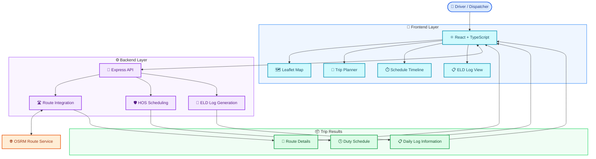
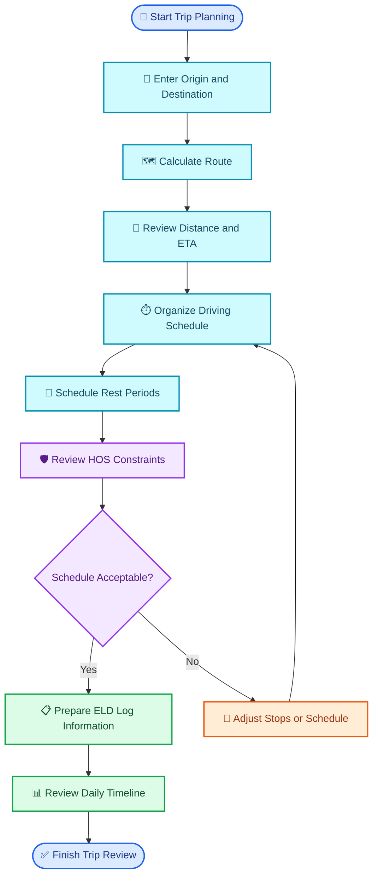
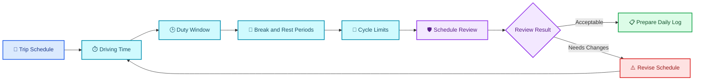
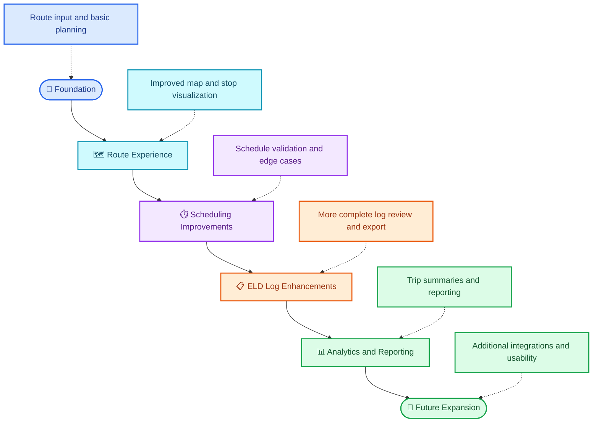

# 🚛 HOS Route Planner & ELD Log Generator

<p align="center">
  
</p>

<p align="center">
  
</p>

<p align="center">
  <a href="https://hos-route-planner-ruddy.vercel.app/">
    
  </a>
  <a href="https://github.com/dhanushgopi2456/hos-route-planner">
    
  </a>
</p>

<p align="center">
  
  
  
  
  
  
</p>

<p align="center">
  
  
  
  
</p>

> A logistics-focused web application for planning commercial routes, organizing driving schedules, and generating electronic logging device (ELD) log information.

---

## 📑 Table of Contents

<p align="center">
  <a href="#-overview">Overview</a> •
  <a href="#-features">Features</a> •
  <a href="#-technology-stack">Tech Stack</a> •
  <a href="#architecture">Architecture</a> •
  <a href="#-route-to-eld-workflow">Workflow</a> •
  <a href="#hos">HOS</a> •
  <a href="#-installation">Installation</a> •
  <a href="#-deployment">Deployment</a> •
  <a href="#roadmap">Roadmap</a>
</p>

---

## 🌟 Overview

The **HOS Route Planner & ELD Log Generator** combines route planning, geospatial visualization, Hours of Service (HOS) scheduling, and ELD log generation in one web application.

The project aims to make commercial trip planning easier by organizing route information, estimated travel, duty schedules, rest periods, and daily log information in a structured workflow.

### 🎯 Project Objectives

- 🗺️ Visualize commercial routes geographically.
- 🚛 Organize trip and stop information.
- ⏱️ Plan driving and rest schedules.
- 🛡️ Support HOS-related checks and schedule review.
- 📋 Generate structured ELD daily log information.
- 📄 Make trip information easier to review and export where supported.

---

## ✨ Features

<table>
<tr>
<td width="50%">

### 🗺️ Route Planning

- Origin and destination inputs
- Route visualization
- Trip-distance and travel-time information
- Map-based route exploration

</td>
<td width="50%">

### ⏱️ HOS Scheduling

- Driving and duty-time planning
- Rest-period scheduling
- Schedule timeline organization
- HOS-related validation workflows

</td>
</tr>
<tr>
<td width="50%">

### 📋 ELD Log Generation

- Daily log information
- Driving and rest event organization
- Trip timeline representation
- Reviewable log output

</td>
<td width="50%">

### 📊 Trip Management

- Route and stop information
- Timeline-based trip review
- Compliance-oriented schedule inspection
- Clear visual presentation of trip details

</td>
</tr>
</table>

---

## 🧰 Technology Stack

| Technology | Purpose |
|---|---|
| React 19 | Frontend user interface |
| TypeScript | Type-safe application development |
| Tailwind CSS v4 | Responsive styling |
| Leaflet | Interactive maps and route visualization |
| Node.js | JavaScript runtime |
| Express.js | Backend API framework |
| OSRM | Route-service integration |
| Vercel | Live application deployment |

The exact availability of each feature depends on the current implementation and configuration in the repository.

---
<a id="architecture"></a>
## 🏗️ System Architecture

The following architecture diagram is written in Mermaid and renders directly on GitHub. It does not require an external image host.



---

## 🔄 Route-to-ELD Workflow

This flowchart illustrates the intended high-level trip workflow.



---
<a id="hos"></a>
## 🛡️ Hours of Service (HOS)

Hours of Service rules help organize driving and rest schedules for commercial drivers.

The following diagram illustrates common U.S. property-carrying driver rule categories. It is an explanatory workflow, not proof that every regulatory exception or condition is implemented in this project.



### HOS concepts

- Driving-time limits
- Duty-window constraints
- Required breaks
- Off-duty and sleeper-berth rest periods
- Cycle limits and resets
- Daily duty-status event organization

Regulatory requirements depend on the driver's operation, applicable exceptions, and other conditions. Validate generated schedules against the current official rules before relying on them operationally.

---

## 🎨 Visual Design

<p align="center">
  
  
  
  
</p>

The README uses blue, cyan, purple, and green accents to distinguish the main application layers and workflow stages.

The hero banner and typing animation are external animated images. The Mermaid diagrams are static, interactive only to the extent supported by GitHub's diagram viewer, and do not need to be uploaded as separate screenshots.

---

## ⚙️ Prerequisites

Before running the project locally, ensure you have the tools and services required by the repository:

- Node.js and npm
- Git
- A compatible browser
- Any required backend environment variables
- Any database or external service configured by the project

The backend setup depends on the actual repository configuration.

---

## 🚀 Installation

### 1. Clone the repository

```bash
git clone https://github.com/dhanushgopi2456/hos-route-planner.git
cd hos-route-planner
```

### 2. Inspect the project files

```bash
git status
```

Check the repository's `package.json`, backend configuration, and environment example files before installing dependencies.

### 3. Install dependencies

Run the install command from the directory containing the relevant `package.json`.

```bash
npm install
```

If the repository separates the frontend and backend into different packages, install dependencies in each relevant directory.

### 4. Configure environment variables

If the application uses environment variables, create the required local environment file based on the project's example configuration.

Never commit API keys, credentials, tokens, or production secrets.

### 5. Start the application

Use the scripts defined in the project's `package.json`.

```bash
npm run dev
```

If the frontend and backend have separate startup scripts, start them according to the repository's documentation. The commands above are general guidance; use the scripts actually present in your checkout.

---
## 📸 Screenshots

Explore the key features of the HOS Route Planner & ELD Log Generator through the screenshots below.

### Trip Planner Dashboard

<p align="center">
  
</p>

### Trip Details & Location Selection

<p align="center">
  
</p>

### Interactive Route Map

<p align="center">
  
</p>

### Trip Schedule & HOS Timeline

<p align="center">
  
</p>

### Daily ELD Log Sheets

<p align="center">
  
</p>

### HOS Compliance Validation & Trip Summary

<p align="center">
  
</p>


---

## 🌐 Deployment

<p align="center">
  <a href="https://hos-route-planner-ruddy.vercel.app/">
    
  </a>
</p>

The project has a Vercel deployment:

**Live demo:** https://hos-route-planner-ruddy.vercel.app

Deployment requirements may include build configuration, environment variables, and backend hosting or external-service configuration. Verify these settings against the current deployment.

---

## 🧪 Testing and Validation

Test the application before deploying changes.

Suggested validation checklist:

- [ ] Route input validation
- [ ] Route results display correctly
- [ ] Schedule calculations behave as expected
- [ ] Rest periods are represented correctly
- [ ] HOS review handles invalid schedules
- [ ] ELD log information matches the trip timeline
- [ ] External service failures are handled gracefully
- [ ] Production environment variables are configured securely

These are suggested validation tasks, not a claim that every test already exists in the repository.

---
<a id="#roadmap"></a>
## 🗺️ Roadmap

The following are possible future improvements; they should not be interpreted as already implemented.



Potential enhancements:

- [ ] Improve route and stop visualization
- [ ] Expand schedule validation and edge-case handling
- [ ] Enhance ELD log review and export workflows
- [ ] Add trip summaries and reporting
- [ ] Improve automated tests
- [ ] Strengthen error handling and observability
- [ ] Improve accessibility and responsive layouts

---

## 🔐 Security and Reliability

Recommended practices for continued development:

- Keep secrets in environment variables.
- Validate all incoming API data.
- Handle route-service failures.
- Test scheduling boundary conditions.
- Avoid treating generated logs as automatically certified compliance records.
- Verify production configuration before deployment.

---

## 👨‍💻 Developer

<p align="center">
  <b>Dhanush Gopi Kavala</b>
</p>

<p align="center">
  <a href="https://github.com/dhanushgopi2456">
    
  </a>
  <a href="https://www.linkedin.com/in/dhanush-gopi-kavala-a460a528b/">
    
  </a>
</p>

---

## 📄 License

Refer to the repository's license file for licensing terms. If the repository does not contain a license, usage and redistribution permissions may be limited.

<p align="center">
  
</p>

<p align="center">
  <b>🚛 Route Planning · 🛡️ HOS Scheduling · 📋 ELD Log Generation</b>
</p>
